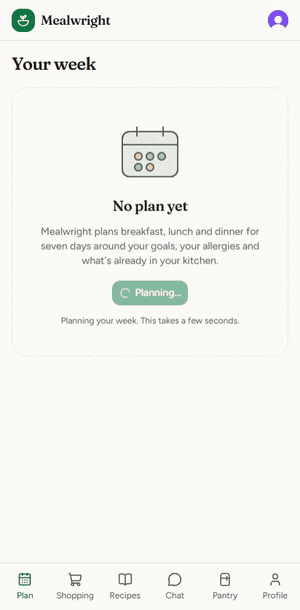
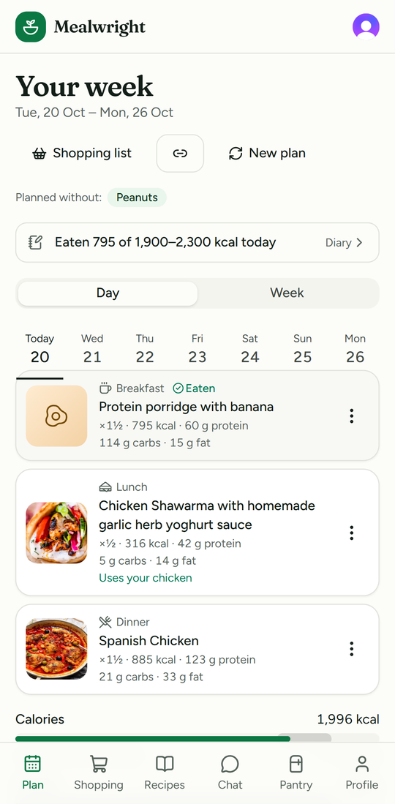
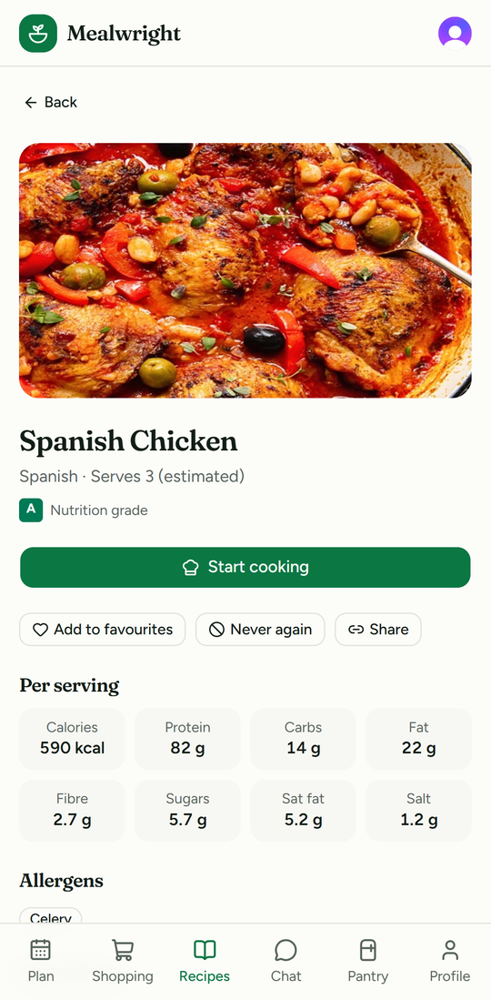
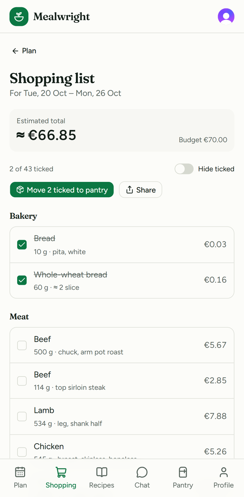
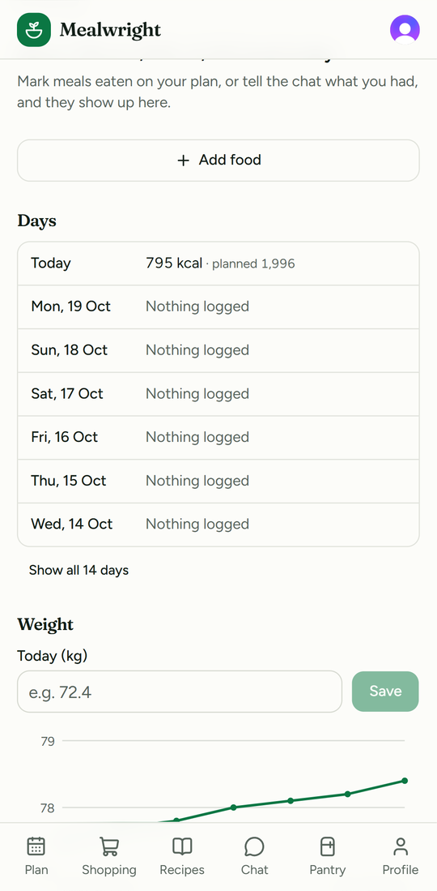
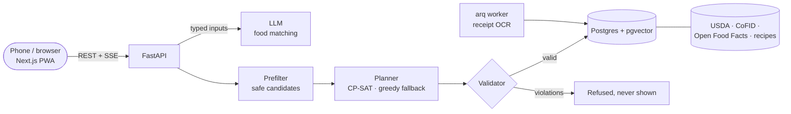

# Mealwright

A meal planner that builds your week around what's already in your kitchen, and re-plans when
the week doesn't go to plan.

**Live demo: [the-mealwright.vercel.app](https://the-mealwright.vercel.app)**. Press "Try the
demo" to sign in to a shared account, no sign-up needed. It runs on free hosting, so the first
load after a quiet spell takes about a minute while the server wakes up.

<p align="center">
  
</p>

<p align="center">
  
  
  
  
</p>

## The idea

A language model asked for a week of meals returns something that looks right. It can also put
peanuts in an allergic person's lunch, make up a recipe, or miss the calorie target by 600 kcal.
So Mealwright doesn't let a model make the plan:

- **A constraint solver (OR-Tools CP-SAT) makes the plan.** Allergens, diet, calorie floor,
  daily calorie range, portions, repeats and budget are hard constraints. Using up the pantry,
  cost, waste and preferences are scored.
- **A separate validator checks every plan** before it's shown, whichever planner made it. It
  shares no code with the solver, so the solver never marks its own homework.
- **A model is used only for language:** when a food name is ambiguous, Claude picks which food
  from the database it means. Without an API key, an offline matcher decides instead.



## Results

| What | Result | Source |
|---|---|---|
| Plans with a safety violation (allergen, diet, avoided food, calorie floor) | **0 of 200** | [evals/REPORT.md](evals/REPORT.md) |
| Plans with no hard violation at all | **100%** (greedy baseline: 92%) | [evals/REPORT.md](evals/REPORT.md) |
| Share of the pantry the plans use up | 27% (baseline: 14%) | [evals/REPORT.md](evals/REPORT.md) |
| Plan a week, end to end (p95) | 3.6 s | [docs/solver-bench-cpsat.md](docs/solver-bench-cpsat.md) |
| Re-plan through the API (p95) | 1.1 s | [docs/replan-bench-cpsat.md](docs/replan-bench-cpsat.md) |
| Receipt lines read correctly (pasted text) | 98.1% | [docs/receipt-accuracy.md](docs/receipt-accuracy.md) |

Timings are on a development machine. The free host has a tenth of a CPU, so it gets a longer
solver time limit and takes about 15 s per plan for the same quality
([docs/deploy.md](docs/deploy.md)).

## Features

- **Weekly plans** for calories, macros and budget, with optional snacks. Food that expires soon
  gets used first.
- **One-tap changes:** skip, swap, move a meal between days, "had something else", rebuild a
  day, undo. A change keeps the rest of the week as it was where it can.
- **Pantry** from barcode scans, pasted or photographed receipts, or a search of 200,000+ foods
  sold in Ireland and the UK.
- **Shopping list** by aisle, in the pack sizes shops sell, usable offline. It can be shared
  with someone else in the shop.
- **Cooking:** cook mode with timers, "what can I cook now?", leftovers for tomorrow's lunch,
  and a reminder the night before to defrost or marinate.
- **Tracking:** a food diary, a weight trend, vitamins and minerals, and grocery spend from your
  receipts.
- **Recipes** imported from a link and run through the same allergy and nutrition checks.
- **Households, metric or US units, a calendar feed,** and an installable PWA with dark mode.

## Stack

Next.js 16 · TypeScript · Tailwind v4 · TanStack Query · FastAPI · SQLAlchemy 2 · Alembic ·
Postgres + pgvector · Redis + arq · OR-Tools CP-SAT · Clerk · Docker Compose · uv · pnpm ·
pytest + Hypothesis · Vitest · Playwright.

Hosted for free on Vercel (web), Render (API), Neon (Postgres) and Upstash (Redis). There's a
security review in [docs/security-review.md](docs/security-review.md), and a privacy and legal
one in [docs/legal-review.md](docs/legal-review.md).

Design notes: [docs/DESIGN.md](docs/DESIGN.md) and the [decision records](docs/adr). The solver
has its own guide in [packages/solver/README.md](packages/solver/README.md).

## Run it locally

You need Docker and a free [Clerk](https://clerk.com) development instance for sign-in.

1. Copy `.env.example` to `.env` and add the Clerk **Publishable key** and **Secret key**.
   `ANTHROPIC_API_KEY` is optional.
2. Start everything (migrations run automatically), then load foods and recipes:

```sh
docker compose up --build
make seed            # foods (USDA, survey foods, UK CoFID) and recipes, about 2 minutes
make foods           # optional: Irish and UK packaged products from Open Food Facts (~15 min)
```

The web app is on http://localhost:3000 and the API on http://localhost:8000 (docs at `/docs`).
Without `make`, run the `uv run larder-data ...` steps from the Makefile.

To deploy your own copy for free, follow [docs/deploy.md](docs/deploy.md).

## Develop

Needs [uv](https://docs.astral.sh/uv/), Node 22 and pnpm (`corepack enable`).

```sh
make install          # Python and web dependencies, git hooks
make check            # lint, types and tests (what CI runs, minus Docker)
make visual           # every page against its committed screenshot
make gen-api          # after changing API routes: regenerate OpenAPI and the web types
make bench            # planner benchmark (PLANNER=auto|cpsat|greedy)
uv run larder-evals --catalog db --n 50   # regenerate evals/REPORT.md
```

```
apps/api        FastAPI app
apps/web        Next.js app
packages/core   units, nutrition maths, allergen and diet tags, prices
packages/db     SQLAlchemy models and Alembic migrations
packages/data   importers, ingredient matching, curated recipes (CLI: larder-data)
packages/llm    the model client and typed plan changes
packages/solver planning contract, validator, prefilter, greedy baseline, CP-SAT
evals           seeded scenarios and the report (CLI: larder-evals)
docs            design, decision records, benchmarks, deployment
```

The code still uses the project's old name, Larder, for packages, commands and the database.
