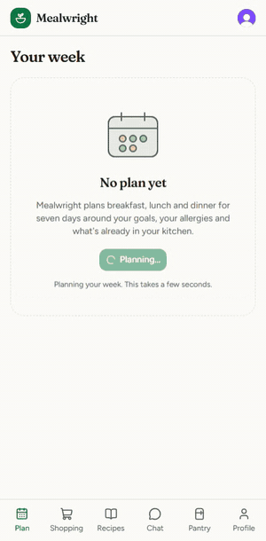
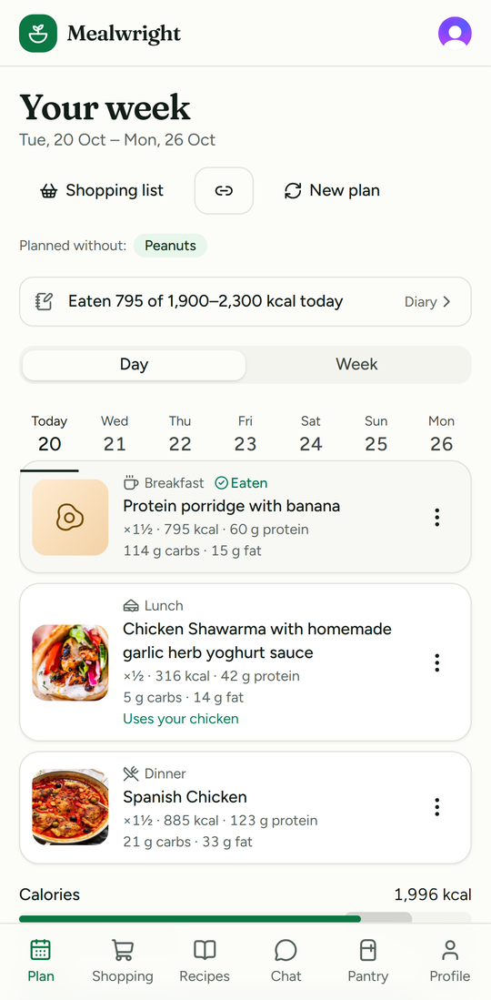
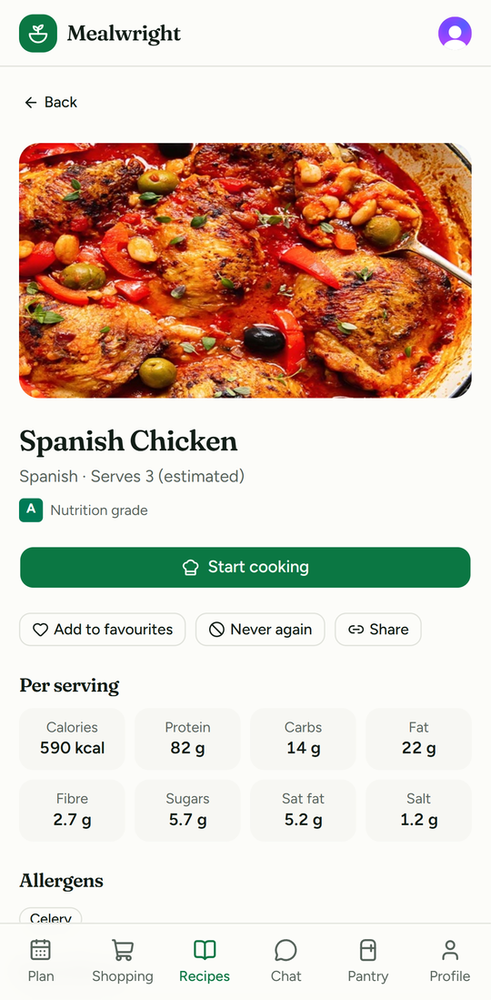
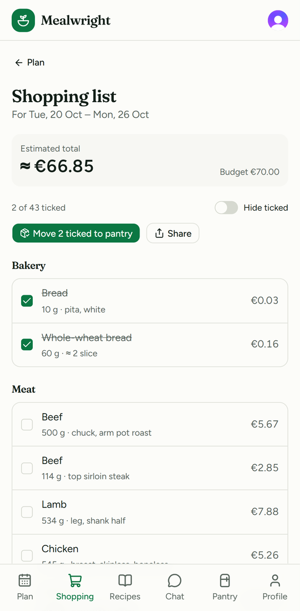
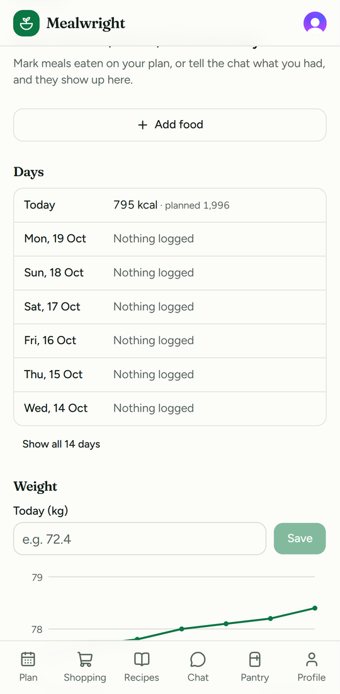
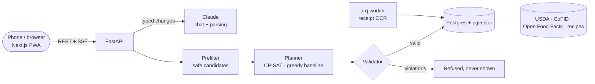

# Mealwright

**Plans your week of meals around what's already in your kitchen, and re-plans in real time
when life happens.** LLM for language, constraint solver for guarantees.

<p align="center">
  
</p>

<p align="center">
  
  
  
  
</p>

## Why it's built this way

Ask a language model to plan a week and it will happily return something that *looks* right:
it may also put peanuts in a peanut-allergic person's lunch, invent a recipe, or land 600 kcal
off target. Mealwright splits the job:

- **Claude handles language**: "had pizza for lunch", "something spicy tonight", "skip
  Thursday dinner" become typed plan changes, and recipes are explained in plain words.
- **A planner handles the plan**: hard rules (allergens, diet, avoided foods, calorie floor,
  daily kcal bands, portions, repeats, budget) and soft goals (pantry use, waste, cost,
  preferences, little churn on a replan).
- **An independent validator checks every plan** before anyone sees it, whichever planner made
  it. It shares no code with the planner, so the planner never grades itself.



## What it does

- **Plans a week** of breakfast, lunch, dinner (and snacks) for your calories, protein, fat,
  carbs and budget, using up what's in your pantry before it expires.
- **Re-plans when life happens**, from the chat or one tap on a meal: skip, swap (pick from
  safe options), "had something else", rebuild a day, undo. Replans keep the rest of the week
  calm (churn is penalised).
- **Stocks the pantry fast**: scan a barcode, paste or photograph a receipt (offline OCR), or
  search 200,000+ foods sold in Ireland and the UK. Product photos and nutrition grades
  (Nutri-Score method) from Open Food Facts.
- **Cooks from what you have**: "What can I cook?" lists the safe recipes that use your pantry,
  fewest things to buy first, and names what's still needed.
- **Shops and cooks**: an aisle-sorted shopping list that works offline in the shop and moves
  ticked items into the pantry; cook mode with scaled amounts, timers read from the method and
  the screen kept awake.
- **Learns your prices and tastes**: prices from your own receipts; favourite recipes, "never
  again", foods you love or hate.
- **Tracks what you ate**: a food diary against your goals, a weight trend, and quick-add for
  anything off the plan (search or scan, exact amounts; the rest of the day rebalances).
- **Vitamins and minerals**: iron, calcium, potassium, vitamins C and D, folate and B12 per
  recipe and for an average day of the plan, against the reference intakes on food labels
  (USDA and UK CoFID data; "no data" rather than a guess when a food has no value).
- **Imports recipes from a link**: reads the recipe data most recipe sites publish, splits the
  ingredients, lets you check them, then runs the same allergy and nutrition checks as every
  other recipe. The fetch is SSRF-guarded (public addresses only, re-checked on redirects).
- **Spending insights**: weekly grocery spend from your receipts beside what the plan expected,
  and the aisles the money went on.
- **Shares and syncs**: a read-only link to a recipe or a week (revocable, nothing personal in
  it), and a private calendar feed so meals show up in Google, Apple or Outlook Calendar.
- **Cook once, eat twice**: cook extra tonight and tomorrow's lunch becomes the leftovers.
- **Cooks for the household**: say how many you cook for; the shopping list, cost, budget,
  pantry use and recipe amounts cover everyone, while calories and nutrition stay yours.
- **Fits a busy week**: every recipe says about how long it takes (estimated from its method),
  recipes filter to "under 30 min", and on the busy nights you pick, dinner stays quick.
- **Thinks a day ahead**: "Tonight, for tomorrow" says what to take out of the freezer and what
  to marinate or soak, on the plan and as an evening notification.
- **Any recipe to the list**: a recipe's missing ingredients go on the shopping list in one tap,
  scaled to the servings you'll cook.
- **Installable and offline**: PWA with a hand-written service worker; light, dark or system
  theme; phone-first with a desktop layout.

## Measured

| What | Result | Source |
|---|---|---|
| Plans with a safety violation (allergen, diet, avoided food, calorie floor) | **0 of 200** | [evals/REPORT.md](evals/REPORT.md) |
| Plans with no hard violation at all | 94% (100% where a valid plan is known to exist) | [evals/REPORT.md](evals/REPORT.md) |
| Plan a week, end to end (p95) | 66 ms | [evals/REPORT.md](evals/REPORT.md) |
| Replan through the API (p95) | 319 ms | [docs/replan-bench-greedy.md](docs/replan-bench-greedy.md) |
| Receipt lines read correctly, end to end (pasted text) | 98.1% | [docs/receipt-accuracy.md](docs/receipt-accuracy.md) |

These numbers are for the greedy baseline planner standing in while the CP-SAT model is being
written. The LLM-only comparison (`larder-evals --llm`, paid) is wired up and runs on request.

## Stack

Next.js 16 (App Router, Cache Components) · TypeScript · Tailwind v4 · TanStack Query ·
FastAPI · SQLAlchemy 2 · Alembic · Postgres + pgvector · Redis + arq · OR-Tools CP-SAT ·
Claude (Sonnet for chat, Haiku for small structured calls) · Clerk · Docker Compose · uv ·
pnpm · pytest + Hypothesis · Vitest + Testing Library · Playwright.

Design: [docs/DESIGN.md](docs/DESIGN.md) and the [architecture decision records](docs/adr).
Build plan: [PLAN.md](PLAN.md). Progress: [docs/progress.md](docs/progress.md).

> Formerly "Larder". The product name lives in `apps/web/src/lib/brand.ts` and
> `packages/core/src/larder_core/brand.py`; internal identifiers (`larder_*` packages, commands,
> Docker and database names) keep the old name so existing setups and data keep working.

## Run it

Requires Docker and a free [Clerk](https://clerk.com) development instance (for sign-in).

1. In the Clerk dashboard, create an application and copy its **Publishable key** and
   **Secret key**.
2. `cp .env.example .env` and paste them into `CLERK_PUBLISHABLE_KEY` / `CLERK_SECRET_KEY`.
   Optionally add `ANTHROPIC_API_KEY` for the AI chat; without it the chat still changes your
   plan from plain requests ("skip dinner tonight", "had pizza for lunch").
3. Start everything (migrations run automatically), then load foods and recipes:

```sh
docker compose up --build
make seed            # needs uv; foods (USDA, survey foods, UK CoFID) and recipes, ~2 minutes
make foods           # optional: Irish + UK packaged products from Open Food Facts (~15 min)
```

Without `make`, run the same `uv run larder-data ...` steps listed in the Makefile.

Updating an existing database: migrations run by themselves, but new food data (such as the
vitamins and minerals) arrives only when the importers run again: `make seed`, then
`make foods` if you used it before. They update foods and recipes in place.

Barcode scanning finds imported products offline. To also look up products that aren't imported
yet, set `OFF_USER_AGENT` in `.env` (Open Food Facts asks for `AppName/Version (contact email)`;
only the barcode is sent). The camera works on `localhost` or HTTPS.

- Web: http://localhost:3000 (works on a phone on the same network via your machine's IP if you
  add it to `CORS_ORIGINS` and rebuild with that `NEXT_PUBLIC_API_URL`)
- API: http://localhost:8000 (docs at `/docs`, readiness at `/readyz`)

To run the end-to-end test in CI, add the same two keys as repository secrets
`CLERK_PUBLISHABLE_KEY` and `CLERK_SECRET_KEY`.

To put it online for free (Vercel, Render, Neon, Upstash) with a public demo account, see
[docs/deploy.md](docs/deploy.md).

## Develop

Requires [uv](https://docs.astral.sh/uv/), Node 22 and pnpm (`corepack enable`).

```sh
make install          # Python + web deps, git hooks
docker compose up db redis -d && make seed
uv run uvicorn larder_api.main:app --reload    # API on :8000 (reads .env)
pnpm -C apps/web dev                           # web on :3000; put NEXT_PUBLIC_CLERK_PUBLISHABLE_KEY
                                               # and CLERK_SECRET_KEY in apps/web/.env.local
pnpm -C apps/web e2e                           # Playwright, needs CLERK_* keys exported
SHOTS=1 pnpm -C apps/web e2e pages             # + accessibility check of every page, light/dark,
                                               #   phone/desktop; screenshots in e2e-shots/
MEDIA=1 pnpm -C apps/web e2e media --project=setup --project=phone &&   (cd apps/web && sh scripts/readme-media.sh)   # README screenshots and GIF (needs ffmpeg)
make visual           # every page against its committed screenshot, in the Playwright Linux
                      #   container (make visual-update after a deliberate UI change)
make check            # lint, types, tests (what CI runs, minus Docker)
make gen-api          # after changing API routes: regenerate OpenAPI + web types
make migrate          # apply DB migrations
make data             # import USDA + TheMealDB + curated recipes, resolve, write report (~4 min)
make bench            # planner benchmark on the seeded catalog (PLANNER=auto|cpsat|greedy)
uv run larder-evals --catalog db --n 50   # evals/REPORT.md (add --llm --yes for the paid baseline)
make llm-smoke        # four real chat turns against Claude (needs ANTHROPIC_API_KEY; ~5 cents)
uv run pytest packages/solver/tests/test_solve.py   # the spec the CP-SAT solve() must pass
```

## Layout

```
apps/api        FastAPI app
apps/web        Next.js app
packages/core   units, measure parsing, nutrition math, allergen/diet tags, prices (pure)
packages/db     SQLAlchemy models + Alembic migrations
packages/data   importers, ingredient normaliser, embeddings, curated recipes (CLI: larder-data)
packages/llm    Claude clients, typed plan changes and tools, agent loop, offline rule parser
packages/solver planning contract, validator, prefilter, greedy baseline, CP-SAT solve() (pure)
                — modelling guide: packages/solver/README.md
evals           seeded scenarios, LLM-only baseline, report (CLI: larder-evals)
docs/           DESIGN.md, ADRs, progress notes, benchmark reports
```
